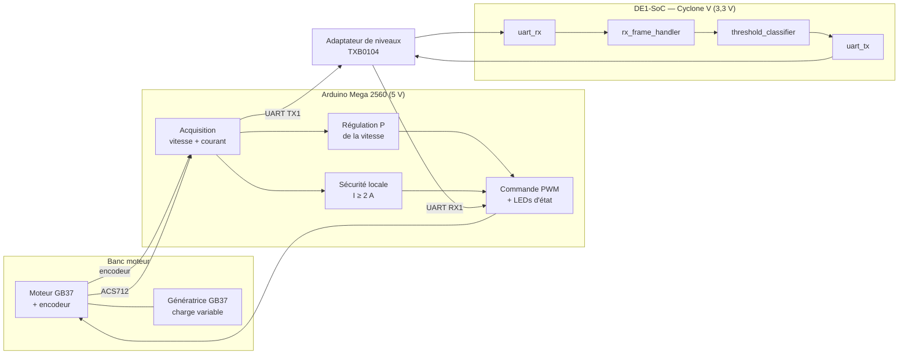
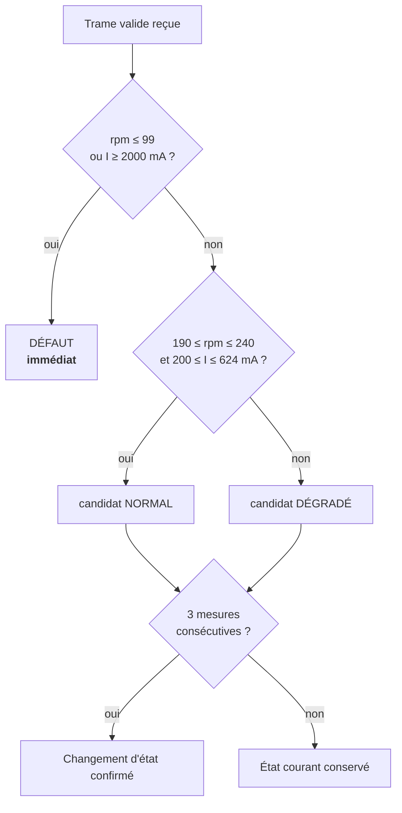

# Surveillance d'un moteur CC — Plateforme hybride Arduino + FPGA

> Système embarqué temps réel qui classe l'état d'un moteur à courant continu en **NORMAL**, **DÉGRADÉ** ou **DÉFAUT** à partir de sa vitesse et de son courant. L'acquisition se fait sur un **Arduino Mega 2560** et la classification sur un **FPGA DE1-SoC (Cyclone V)**, en VHDL.

Projet réalisé dans le cadre du stage **GEN5001 — Stage en milieu de travail I**
Université du Québec en Outaouais · Baccalauréat en génie informatique · Été 2026

---

## Sommaire

- [Objectif](#objectif)
- [Architecture](#architecture)
- [Protocole de communication](#protocole-de-communication)
- [Classifieur FPGA](#classifieur-fpga)
- [Firmware Arduino](#firmware-arduino)
- [Calibration](#calibration)
- [Défis rencontrés](#défis-rencontrés)
- [Contenu du dépôt](#contenu-du-dépôt)
- [Ouvrir le projet](#ouvrir-le-projet)

---

## Objectif

Concevoir, réaliser et valider une plateforme capable de **surveiller en temps réel** un moteur à courant continu et de **détecter automatiquement sa dégradation**. Le banc d'essai utilise deux motoréducteurs GB37 couplés mécaniquement :

- Le premier est le moteur surveillé.
- Le second fonctionne en génératrice et applique une **charge résistive variable**, ce qui permet de reproduire différentes conditions de fonctionnement et de dégradation.

## Architecture

| Rôle | Composant |
|---|---|
| Acquisition, régulation, commande | Arduino Mega 2560 |
| Classification de l'état | FPGA DE1-SoC (5CSEMA5F31C6), horloge 50 MHz |
| Mesure du courant | ACS712 20 A (100 mV/A) |
| Mesure de la vitesse | Encodeur 16 PPR, réduction 43,8:1 |
| Puissance moteur | Pont en H (ENA / IN1 / IN2) |
| Liaison 5 V ↔ 3,3 V | SparkFun TXB0104 (BOB-11771) |

## Protocole de communication

La liaison est un UART bidirectionnel à **115 200 bauds, 8N1**, avec un cycle d'échange de **100 ms (10 Hz)**. Les deux côtés partagent les mêmes constantes (`package_constants.vhd` ↔ `.ino`).

**Trame Arduino → FPGA (7 octets, poids fort en premier)**

| `0xAA` | RPM H | RPM L | Courant H | Courant L | Checksum | `0x55` |
|---|---|---|---|---|---|---|
| début | vitesse (tr/min) | | courant (mA) | | XOR des 4 octets | fin |

**Trame FPGA → Arduino (3 octets)**

| `0xAA` | État | `0x55` |
|---|---|---|
| début | `0x01` NORMAL · `0x02` DÉGRADÉ · `0x03` DÉFAUT | fin |

## Classifieur FPGA

| État | Vitesse (tr/min) | Courant (mA) | Réaction de l'Arduino | LED |
|---|---|---|---|---|
| **NORMAL** | 190 – 240 | 200 – 624 | PWM de consigne | verte |
| **DÉGRADÉ** | toute autre combinaison | | PWM ÷ 2 | orange |
| **DÉFAUT** | ≤ 99 | ou ≥ 2000 | moteur coupé | rouge clignotante |

**Choix de conception**

- Une transition **NORMAL ↔ DÉGRADÉ** doit être observée sur **3 mesures consécutives** avant d'être confirmée. Le classifieur garde pour cela un état courant, un état candidat et un compteur. Ce filtre évite les oscillations dues au bruit de mesure.
- Un **DÉFAUT est appliqué immédiatement**. Une première version le confirmait aussi sur 3 mesures, soit jusqu'à environ 300 ms de retard. Ce délai a été retiré pour des raisons de sécurité.

**Modules VHDL**

| Module | Rôle |
|---|---|
| [`package_constants`](rtl/package_constants.vhd) | Horloge, débit, codes d'état, seuils, nombre de confirmations |
| [`uart_rx`](rtl/uart_rx.vhd) | Réception série avec **double synchronisation** anti-métastabilité |
| [`rx_frame_handler`](rtl/rx_frame_handler.vhd) | Machine à états de décodage de trame et vérification du checksum |
| [`threshold_classifier`](rtl/threshold_classifier.vhd) | Classification par seuils et confirmation sur 3 mesures |
| [`uart_tx`](rtl/uart_tx.vhd) | Émission de la trame d'état `AA · état · 55` |
| [`top_motor_classifier`](rtl/top_motor_classifier.vhd) | Intégration structurelle des quatre modules |
| [`tb_threshold_classifier`](sim/tb_threshold_classifier.vhd) | Banc d'essai du classifieur |

## Firmware Arduino

- Mesure de la **vitesse** par interruption sur l'encodeur (1401,6 fronts par tour de sortie), calculée toutes les 100 ms.
- Mesure du **courant** sur 50 échantillons moyennés, avec **auto-étalonnage du zéro** de l'ACS712 au démarrage.
- **Régulation proportionnelle** du PWM vers une vitesse cible saisie au moniteur série (0 – 300 tr/min).
- **Phase de démarrage de 2 s**, pendant laquelle le verdict du FPGA est ignoré : à l'arrêt, la vitesse nulle serait classée DÉFAUT et le moteur ne pourrait jamais démarrer.
- **Sécurité locale indépendante du FPGA** : le moteur est coupé dès que le courant atteint 2 A, avec réarmement manuel (`r`).
- Réception de la réponse du FPGA par machine à états, avec resynchronisation.

## Calibration

Le classeur `Calibration_GEN5001_ordonnee (1).xlsx` regroupe la campagne de mesures sur le banc de charge :

- **Données brutes** : dix séries appariées par palier de charge.
- **Séries établies** : retrait uniforme de la phase de démarrage. On écarte les échantillons antérieurs au premier qui atteint 95 % de la médiane des 100 derniers.
- **Synthèse** : moyenne, écart-type et plage **±2σ** par palier. Ces plages ont servi à fixer les seuils du classifieur.
- **Dérive** : évolution du courant au cours de chaque acquisition.

## Défis rencontrés

1. **Trames rejetées à l'intégration malgré des simulations correctes.**
   - Cause : le signal RX, asynchrone par rapport à l'horloge du FPGA, était utilisé directement (risque de métastabilité), et le diviseur de baud avait une erreur d'un cycle.
   - Correctif : synchronisation à deux bascules et correction du compteur.
   - Leçon : une simulation fonctionnelle réussie ne garantit pas le fonctionnement sur le matériel.
2. **Oscillation NORMAL ↔ DÉGRADÉ en régime nominal.** Le courant sortait parfois de la plage calibrée quand les conditions expérimentales variaient. Le filtre de confirmation atténue le problème, et une **hystérésis** sur les seuils est identifiée comme amélioration future.

## Contenu du dépôt

| Fichier | Description |
|---|---|
| [`rtl/`](rtl/) | Sources VHDL du FPGA, lisibles directement |
| [`sim/`](sim/) | Banc d'essai du classifieur |
| [`quartus/`](quartus/) | Fichiers de projet Quartus (`.qpf`, `.qsf` avec l'assignation des broches) |
| `Codage_FPGA_complet.qar` | Archive complète du projet Quartus Prime, telle que livrée |
| `GEN5001_arduino_complet.ino` | Firmware de l'Arduino Mega 2560 |
| `Calibration_GEN5001_ordonnee (1).xlsx` | Données et analyse de la campagne de calibration |
| `Rapport_Stage_GEN5001_Tahoc_Wokam_Durrice_Lea (1).pdf` | Rapport final de stage (20 pages) |

## Ouvrir le projet

**FPGA**

1. Dans Quartus Prime (25.1 Lite ou plus récent), ouvrir *Project → Restore Archived Project…* et choisir `Codage_FPGA_complet.qar`. Les dossiers `rtl/`, `sim/` et `quartus/` sont une copie lisible du contenu de cette archive.
2. Le *top-level* est `top_motor_classifier` et la cible est `5CSEMA5F31C6`.

| Signal | Broche DE1-SoC |
|---|---|
| `clk` (50 MHz) | `PIN_AF14` |
| `key_reset_n` (KEY0) | `PIN_AA14` |
| `rx` | `PIN_AC18` (GPIO) |
| `tx` | `PIN_Y17` (GPIO) |

**Arduino**

1. Ouvrir `GEN5001_arduino_complet.ino` dans l'IDE Arduino et téléverser sur une carte Mega 2560.
2. Câbler la liaison FPGA sur `TX1` (D18) et `RX1` (D19), en passant par l'adaptateur de niveaux.
3. Ouvrir le moniteur série à 115 200 bauds :
   - un nombre (`0`–`300`) fixe la vitesse cible en tr/min ;
   - `s` arrête le moteur ;
   - `r` réarme la sécurité.
